<p align="center">
  
</p>

<p align="center">
  <strong>Track every bet, stick to your own rules, and see where your money really goes.</strong><br />
  Android app · works in any browser · every sport · fully offline · open source (Apache-2.0)
</p>

<p align="center">
  <a href="#1-what-is-bet-tracker">What is it</a> ·
  <a href="#2-what-you-can-do">Features</a> ·
  <a href="#4-install-or-run-it">Install</a> ·
  <a href="#6-how-the-code-is-organised">Code map</a> ·
  <a href="#9-documentation-index">Docs</a>
</p>

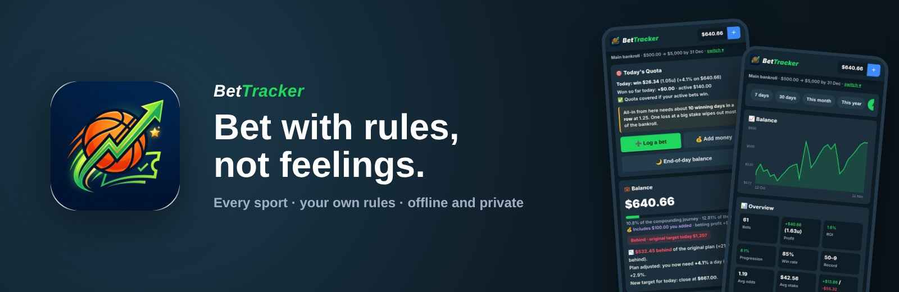

> **New here?** Read sections 1–4 first (about 10 minutes). By the end you'll know what
> Bet Tracker does, how a betting day works in it, and you'll have it running on your phone
> or in your browser.

## Contents

1. [What is Bet Tracker](#1-what-is-bet-tracker)
2. [What you can do](#2-what-you-can-do)
3. [How a betting day works](#3-how-a-betting-day-works)
4. [Install or run it](#4-install-or-run-it)
5. [Words we use](#5-words-we-use)
6. [How the code is organised](#6-how-the-code-is-organised)
7. [Rules that must never break](#7-rules-that-must-never-break)
8. [Working on the code](#8-working-on-the-code)
9. [Documentation index](#9-documentation-index)
10. [Releases](#10-releases)
11. [Status and what's next](#11-status-and-whats-next)
12. [History and people](#12-history-and-people)

---

## 1. What is Bet Tracker

Most punters lose because they break their own rules: one more bet after a loss, odds a
bit longer than planned, a team they swore off. **Bet Tracker** writes your rules down
and holds you to them. The app won't let you place a bet that breaks them.

It's a private record of every bet across **every sport**, plus a goal planner that tells
you how much you need to win today, and stats that show which sports, markets,
bookmakers and tipsters actually make you money.

The whole app is built around one loop:

```
Set a goal → Today's quota → Pick a bet → Your rules check it → Place it
→ Settle it (or scan the slip) → End-of-day balance → Stats show what works → Tighten your rules
```

**What Bet Tracker is not:** a bookmaker, a tipping service or a "get rich" system. It
never takes or places bets, never sells picks, and never sends your data anywhere.

### Rule presets

| Preset                    | What it is                                                                                                                       |
| ------------------------- | -------------------------------------------------------------------------------------------------------------------------------- |
| **Pro Punter** (default)  | The author's own system: odds of 1.25 or less, 3 bets a day, approved leagues only, set bans and a checklist for every sport ([details](docs/RULES.md)) |
| **Careful bankroll**      | Classic bankroll management: max 5% stake, odds up to 2.50, 2 bets a day                                                         |
| **Open**                  | No restrictions. Set your own limits                                                                                             |

Every rule can be edited, and a rule set can be exported as text and shared with anyone.

### What we care about most

- **Privacy:** no accounts, servers, analytics or ads. Everything stays on the device,
  including betslip scanning.
- **Discipline over excitement:** the app's job is to make you stop when your rules say
  stop, not to keep you betting.
- **Safer betting:** you can set deposit and loss limits and take breaks, and help lines
  are one tap away. Everyone confirms they're 18+.
- **Honesty:** the goal planner shows the real maths, including how many wins in a row
  an aggressive goal needs.

## 2. What you can do

On a phone it looks and behaves like a sportsbook app, with bottom tabs **Home · Bets ·
➕ · Stats · Rules**. In a browser it's the same app.

| Today's quota                          | Bet slip                                     | Your rules say no                                     |
| -------------------------------------- | -------------------------------------------- | ----------------------------------------------------- |
| 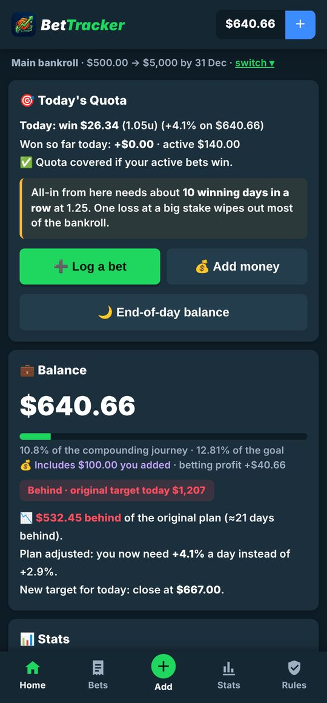 | 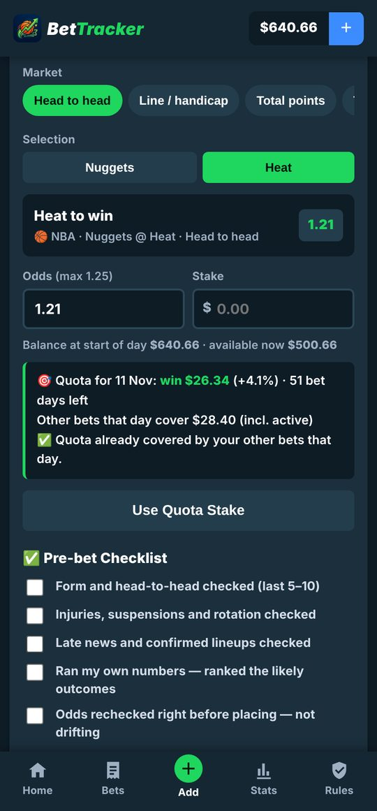 | 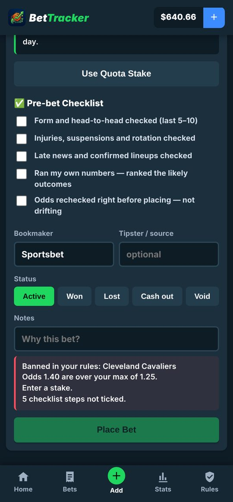 |

| Scan a betslip                          | Open bets                                     | Settled bets                                     |
| --------------------------------------- | --------------------------------------------- | ------------------------------------------------ |
| 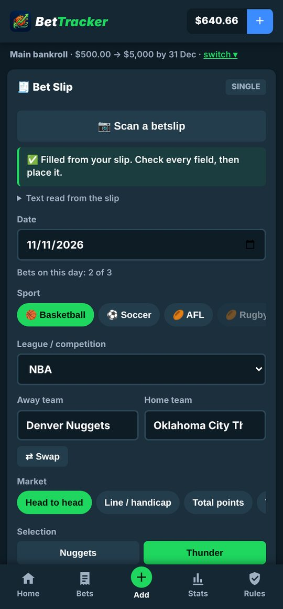 | 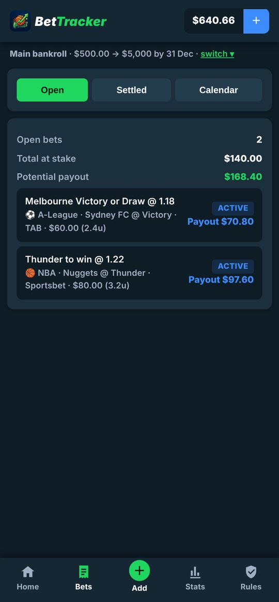 | 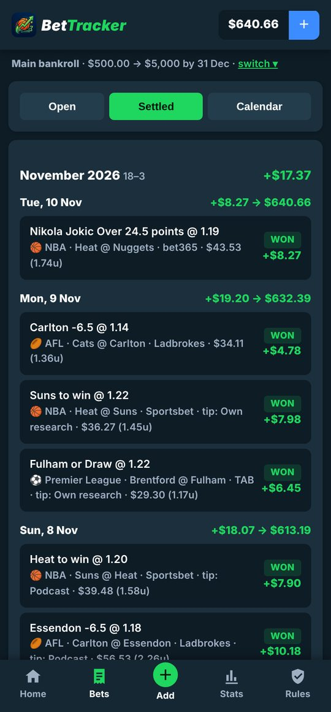 |

| Calendar                                      | A day                                 | End-of-day balance                                   |
| --------------------------------------------- | ------------------------------------- | ---------------------------------------------------- |
| 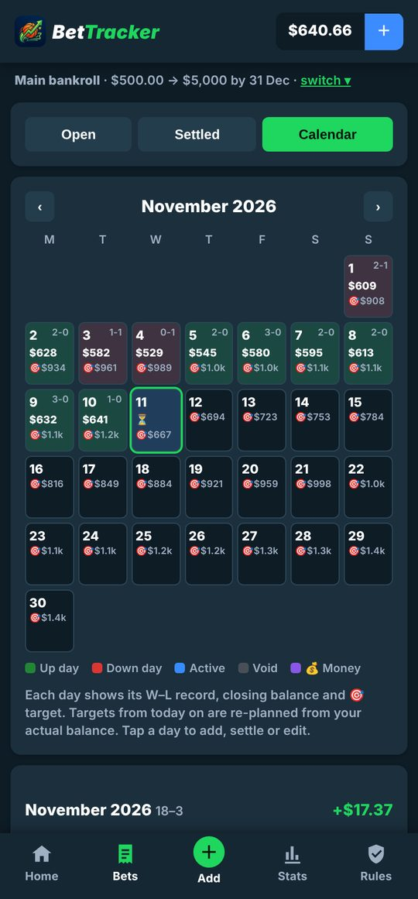 | 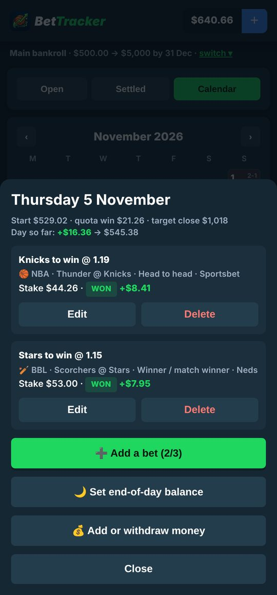 | 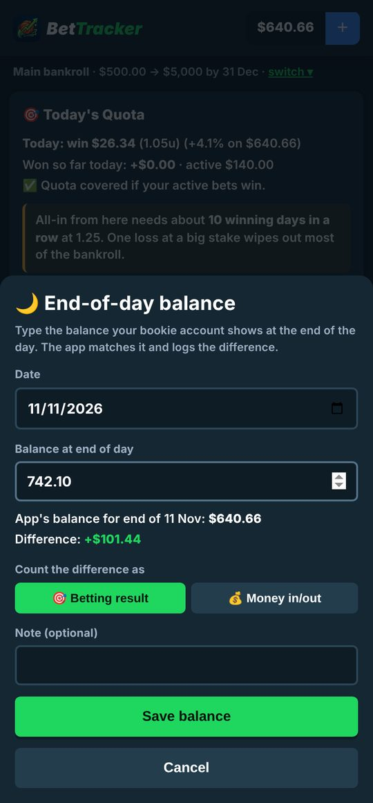 |

| Stats                                   | Results                                              | Breakdown and optimizer                             |
| --------------------------------------- | ---------------------------------------------------- | --------------------------------------------------- |
| 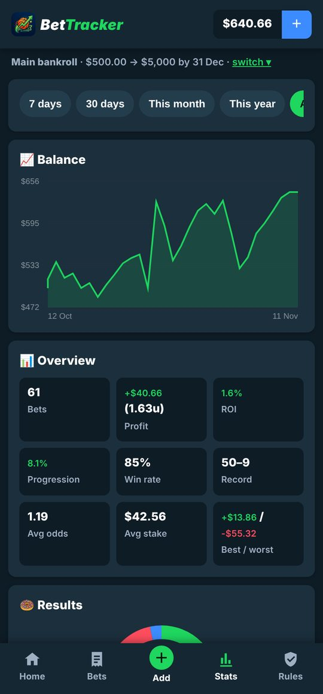 | 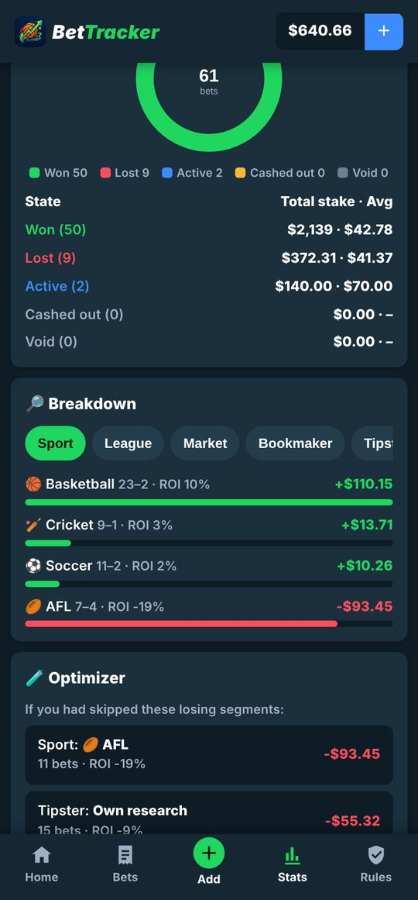 | 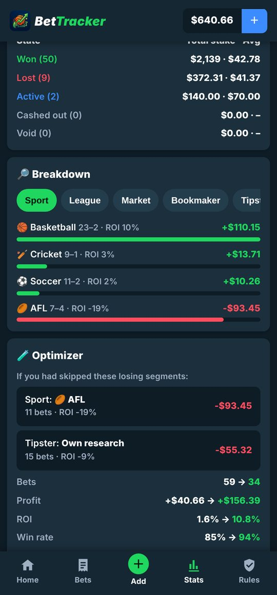 |

| Bankrolls                                       | Rules                                   | Allowed sports and leagues                           |
| ----------------------------------------------- | --------------------------------------- | ---------------------------------------------------- |
| 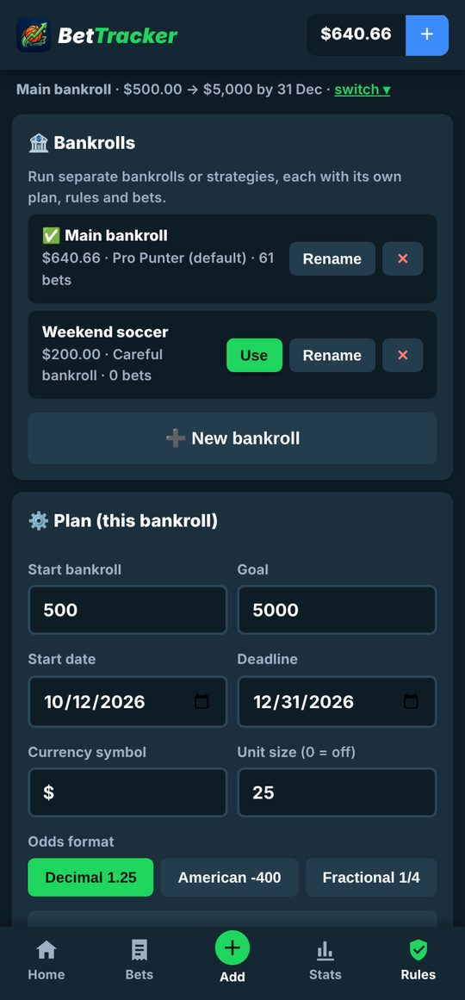 | 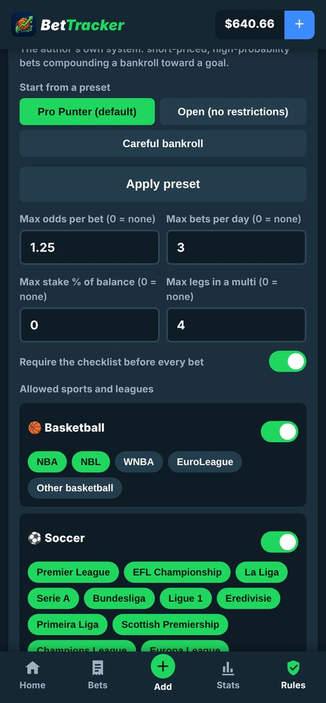 | 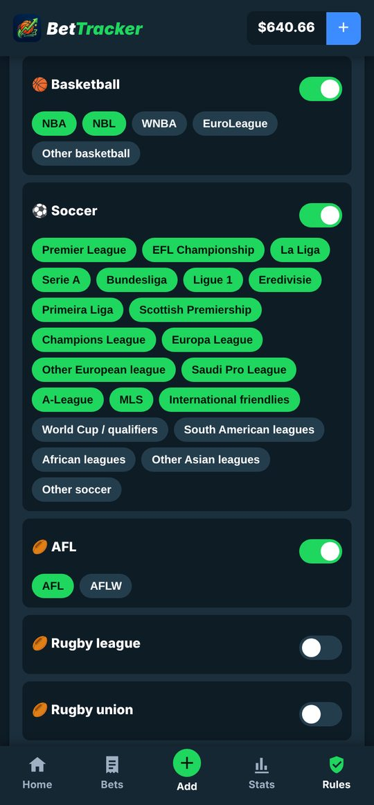 |

| Safer betting                            | Support contacts                       | First run                                    |
| ---------------------------------------- | -------------------------------------- | -------------------------------------------- |
| 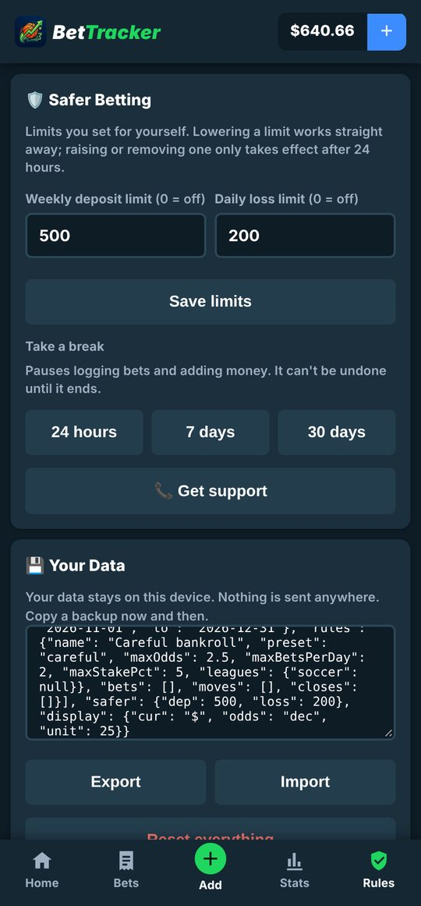 | 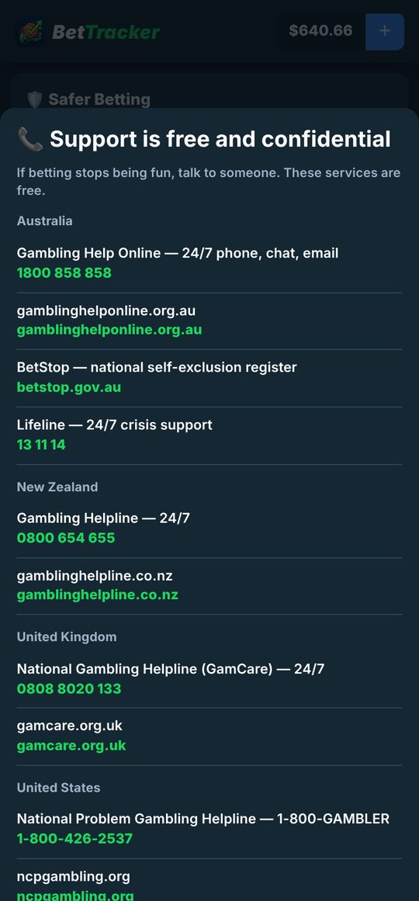 | 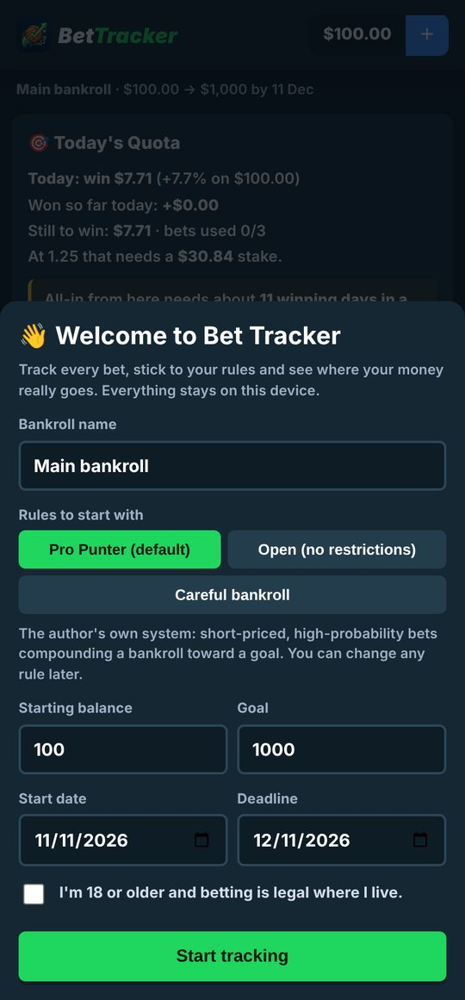 |

You can:

- **Log a bet in any sport:**
  - basketball, soccer, AFL, rugby league and union, cricket, tennis, NFL, MLB, NHL, MMA and boxing, motorsport, golf, racing, or anything else
  - team suggestions for NBA, NBL, NFL, MLB, NHL, AFL, NRL, IPL, BBL, A-League and international cricket; any team or player you type is remembered
- **Pick the market** for each sport: head to head, line, totals, team totals, player props, double chance, BTTS, corners, cards, Asian handicap, scorers, top batter, set handicaps, outrights, podiums, same game multis and multis. The slip writes the bet name for you, for example "Jokic Over 24.5 points".
- **Scan a betslip:** pick a screenshot and the sport, teams, market, odds, stake, bookmaker and result fill in. The reader runs on the phone and nothing is uploaded.
- **Let the app pick the stake:** enter the odds and the stake fills in to hit today's quota.
- **Get stopped when a bet breaks your rules**, with the reason: odds too long, too many bets today, a banned team, player or market, a league you don't bet, stake too big, too many legs, checklist not done, or a limit or break you set.
- **Record what happened:** won, lost, void or cash out (with the amount returned), plus bookmaker, tipster and notes.
- **Keep your balance true:** add or withdraw money, or type your bookie balance at the end of the day and the app logs the difference.
- **Run several bankrolls** (for example "Main" and "Weekend soccer"), each with its own plan, rules and bets.
- **See what works:**
  - balance chart and stats by period: profit, ROI, progression, win rate, record, average odds and stake, best and worst bets
  - a results donut
  - breakdowns by sport, league, market, bookmaker, tipster, odds range, bet type and weekday
  - the **optimizer**, which shows how you'd have done without your worst segments
- **Use your format:** decimal, American or fractional odds, any currency symbol, and an optional unit size.
- **Bet safely:** weekly deposit limit, daily loss limit, and a 24-hour, 7-day or 30-day break. Help lines open in the dialer.
- **Back up and share:** export all data as text, or share just a rule set.

## 3. How a betting day works

| When             | You                                                                 | What the app does                                                                                                                     |
| ---------------- | ------------------------------------------------------------------- | ------------------------------------------------------------------------------------------------------------------------------------- |
| Once             | Set a start balance, goal and deadline, and choose a rule preset    | Works out the daily growth you need and each day's target                                                                              |
| Morning          | Open **Home**                                                       | Shows **today's quota** (what you need to win today) and whether you're ahead of or behind plan                                        |
| Choosing a bet   | Fill in the **bet slip**, or **scan** your bookie's slip            | Checks every rule as you type. Fills in the stake to hit the quota. **Place Bet** stays locked until everything passes               |
| Before placing   | Tick the **checklist** for that sport                               | Won't place the bet until every step is ticked (if your rules require it)                                                              |
| Results come in  | Tap the day in **Bets → Calendar** and mark each bet won, lost or void | Updates the balance, quota, streak and stats                                                                                          |
| Day's end        | Optional: **🌙 End-of-day balance** with your real bookie balance   | Sets the bankroll to match exactly and logs the gap as a result or as money in or out                                                  |
| Tomorrow         | —                                                                   | Re-plans from where you actually are. If you're ahead, the daily need drops, and so do the stakes                                     |
| Every week or so | Open **Stats → Optimizer**                                          | Shows which segments cost you money, so you can ban them in **Rules**                                                                 |
| If it stops being fun | **Rules → Take a break**, or **Get support**                   | Locks bets and deposits for the period you chose, which can't be undone early. Shows free, confidential help lines                    |

## 4. Install or run it

### On Android

1. Download `bet-tracker.apk` from [**Releases**](../../releases).
2. Open it on your phone and allow **Install unknown apps** when Android asks.
3. Updates install over the top and keep your data.

### In a browser

Open `web/index.html`, or host the `web/` folder on any static site (GitHub Pages works:
**Settings → Pages → Deploy from branch → `main` / root**, then open `/web/`). Data is kept
in that browser.

### Build the Android app yourself

You need **Java 17+**, `curl` and `unzip`. You do **not** need Android Studio or the Android SDK.

```bash
git clone https://github.com/pranaysinghal19/bet-tracker.git
cd bet-tracker
./build.sh                                   # -> dist/bet-tracker-unsigned.apk
```

Android only installs signed apps. Make a key once, keep it safe, and sign every release with it:

```bash
keytool -genkeypair -keystore my-release.p12 -storetype PKCS12 -alias bettracker \
        -keyalg RSA -keysize 4096 -validity 12000
BT_KEYSTORE=my-release.p12 BT_KEYSTORE_PASS=… BT_KEY_ALIAS=bettracker ./build.sh
#                                            -> dist/bet-tracker.apk
```

### Try it in 5 minutes

1. Open the app, keep **Pro Punter**, set start `100`, goal `1000`, and tick **18+**.
2. Tap **➕**. Choose basketball, type `Denver Nuggets` and `Miami Heat`, pick **Heat**, and enter odds `1.40`. The slip refuses: the odds are over 1.25.
3. Change the odds to `1.20`. The stake fills in to hit today's quota. Tick the checklist and tap **Place Bet**.
4. On the day sheet, tap **Won**. Home now shows the quota covered and the plan adjusted.
5. Tap **➕** again and type `Cleveland Cavaliers`. Blocked: a banned team.
6. Go to **Rules**, switch on **Tennis**, save, and log a tennis match.
7. Open **Stats** and change the period.

### Everyday commands

| Command                       | What it does                                                    |
| ----------------------------- | --------------------------------------------------------------- |
| `./build.sh`                  | Build an aligned, unsigned APK into `dist/`                     |
| `BT_KEYSTORE=… ./build.sh`    | Build and sign with your key                                    |
| `python3 -m http.server`      | Serve the repo locally, then open http://localhost:8000/web/    |

## 5. Words we use

| Term                  | Meaning                                                                                                     |
| --------------------- | ----------------------------------------------------------------------------------------------------------- |
| **Bankroll**          | A separate pot of money with its own plan, rules and bets. You can have several.                            |
| **Plan**              | Start balance, goal and deadline for a bankroll.                                                            |
| **Quota**             | What you need to win today to stay on pace for the goal. Recalculated from your real balance every day.    |
| **Original / adjusted plan** | The path set on day one, and the path re-plotted from where you are now.                              |
| **Rule set / preset** | Your limits and bans. Presets are starting points, and every rule can be edited.                            |
| **Checklist**         | The pre-bet research steps for a sport. Can be required before a bet is placed.                            |
| **Active**            | Placed but not settled yet. Counts toward the day's quota as if it wins, until you settle it.              |
| **Cash out**          | Settled early for the amount the bookie returned. Profit is that amount minus the stake.                   |
| **End-of-day balance** | Your real bookie balance. The app matches it and logs the gap.                                             |
| **Money in/out**      | Deposits and withdrawals. They change the balance but aren't betting profit.                                |
| **Unit**              | An optional fixed stake size, so results also show in units (for example +1.6u).                            |
| **Optimizer**         | Shows how past results would look without your losing segments. Hindsight, not a forecast.                 |
| **Break**             | A self-imposed pause (24 hours, 7 days or 30 days) that blocks bets and deposits and can't be undone early. |

## 6. How the code is organised

**[docs/FILE_MAP.md](docs/FILE_MAP.md) explains every folder and file in one line each.**
Every source file starts with a comment saying what it is.

```
bet-tracker/
├── web/                       The whole app: plain HTML, CSS and JavaScript (no frameworks, no build step)
│   ├── index.html             Screens and layout, plus the Content Security Policy
│   ├── css/app.css            Theme and components (dark only)
│   ├── js/data.js             Sports, leagues, teams, markets, presets, checklists, help lines (most contributions go here)
│   ├── js/app.js              App logic: storage and validation, money maths, rules engine, screens, stats
│   ├── js/slip.js             Betslip reader: runs the OCR engine, then turns slip text into bet fields
│   ├── img/logo.png           App logo
│   └── vendor/                Tesseract OCR engine and English data (Apache-2.0), loaded only when you scan
├── android/                   Android wrapper (WebView), assembled with apktool (no Android SDK needed)
│   ├── AndroidManifest.xml    App ID io.github.pranaysinghal19.bettracker, no permissions
│   ├── smali/…/bettracker/    MainActivity (locked-down WebView), Chrome (photo picker), Guard (blocks navigation)
│   └── res/                   Icons (adaptive) and app name
├── tools/Sign.java            Signs a release APK with your key (APK Signature Scheme v2 + v3)
├── build.sh                   Downloads pinned, checksum-verified tools, then builds, aligns and signs
├── docs/                      Rules, file map, architecture, Android, decisions, screenshots, logo
├── SECURITY.md                Privacy and security model, and how to report a problem
├── LICENSE · NOTICE           Apache-2.0, and third-party components
└── README.md                  You are here
```

### Technology

| Layer          | What we use                                                                                   |
| -------------- | --------------------------------------------------------------------------------------------- |
| App            | HTML, CSS and vanilla JavaScript (ES5-style, no dependencies), canvas charts                  |
| Storage        | `localStorage` on the device, validated on every load and import                              |
| Betslip reader | tesseract.js-core 5 (WebAssembly) and English LSTM data, bundled and run on the main thread   |
| Android        | WebView wrapper written in smali, packed with Apktool, aligned with zipalign, signed with apksig |
| Security       | Strict Content Security Policy, no network, a navigation guard                                |

### How the pieces talk

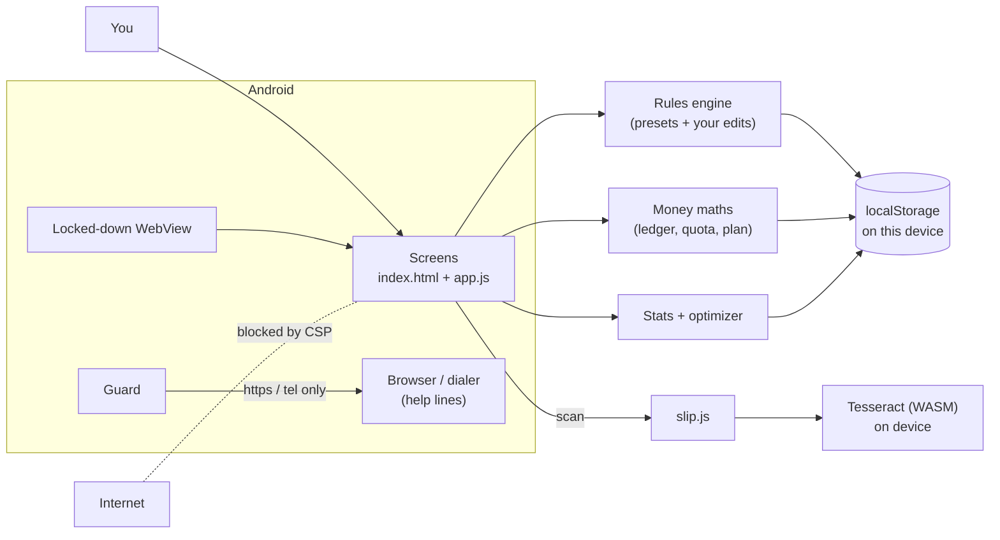

The device is the only place anything is stored. There is no server to trust or breach.

## 7. Rules that must never break

These are product promises and security guarantees. If a change would break one, open
an issue and discuss it first.

**Product**

- **No network, ever.** No accounts, analytics, ads, trackers, remote fonts or "sync".
  The CSP blocks connections, and a pull request that adds one will be declined.
- **The rules decide.** **Place Bet** stays locked while any rule fails. Rules can't
  be bypassed without editing them first.
- **Safer-betting limits only get looser slowly.** Lowering a limit is instant; raising or
  removing one waits 24 hours. A break can't be ended early. Restoring a backup can
  never loosen your current limits.
- **Help is always one tap away** on Home, during a break, and under Rules.
- **18+ only**, confirmed on first run. No tips, picks, odds feeds or affiliate links.
- **Honest maths.** Show what a goal really needs. Never promise profit.

**Engineering**

- **Validate everything.** All stored and imported data goes through `clean()`
  (`web/js/app.js`): unknown fields are dropped, numbers range-checked, text
  length-limited and stripped of `<` and `>`.
- **Escape everything you render.** User text goes through `esc()` before it reaches
  `innerHTML`. Never build HTML from raw input.
- **No inline scripts, no `eval`.** Scripts load from the app's own files only.
  WebAssembly is allowed for OCR and nothing else.
- **The WebView stays locked:** file access off, navigation blocked, no permissions in
  the manifest.
- **Pinned, verified tools.** `build.sh` checks the SHA-256 of everything it downloads.
  Update the hash when you update a tool.
- **Releases are signed with the project's private key**, never a public debug key.
  Keystores never go in the repo (`.gitignore` blocks them).
- **Data compatibility.** Storage key `bettracker_v1`. Old data must keep loading;
  `clean()` fills in anything new with safe defaults.

## 8. Working on the code

### Your first hour

1. Open `web/index.html` in a browser and go through the 5-minute tour (section 4).
2. Read [`docs/RULES.md`](docs/RULES.md) and [`docs/ARCHITECTURE.md`](docs/ARCHITECTURE.md).
3. Follow one bet end to end, the **Place Bet** button:
   1. `#p-log` in `web/index.html`, the bet slip;
   2. `renderForm()` and `buildPick()` in `web/js/app.js`, which build the fields and the bet name;
   3. `validate()`, where every rule is checked and the quota stake is worked out;
   4. `saveBet()` → `cleanBet()` → `save()`;
   5. `ledger()`, which turns bets, money moves and end-of-day balances into a running balance.

### Adding things (the usual order)

- **A league or team list:** edit `web/js/data.js` only. Add `{k, n, teams}` under the sport.
- **A market:** add it to `MARKETS` in `data.js` with its fields (`sel`, `ou`, `line`,
  `player`, `desc`, `legs`), add it to a sport's `markets`, then add a case to
  `buildPick()` in `app.js`.
- **A rule:** add it to the presets in `data.js`, then to `cleanRules()`,
  `validate()` and the Rules screen (`fillRules()` / `saveRules`).
- **A bookmaker the scanner misreads:** add a test slip and adjust `parse()` in `slip.js`.
- **Finish:** test the bet slip, Stats and a backup export/import round trip in a phone-sized
  browser window, then build the APK.

### Git workflow

- `main` is always releasable. Work on a short-lived branch and open a pull request.
- Write commit messages that say **what changed and why**, in plain words.
- Never commit a keystore, password or personal betting data.

### Design

- **Colours:** **Night** `#0E1C26` (background), **Panel** `#152733`, **Card** `#1B2F3C`,
  **Green** `#1FD65F` (actions and wins), **Red** `#FF4D5E` (losses), **Blue** `#3D8CFF` (active).
- **Two rules:** green buttons use dark text for contrast, and the app is dark only.
- **Where things live:** colours are the CSS variables at the top of `web/css/app.css`. The
  logo is `web/img/logo.png` (app) and `android/res/mipmap-*` (launcher icons).
- **Feel:** a sportsbook-style bet slip (selection card with an odds badge, Est. Payout,
  Place Bet), pill tabs, and bold numbers.

## 9. Documentation index

| Document                                       | Read it when you need to…                                     |
| ---------------------------------------------- | ------------------------------------------------------------- |
| [`docs/FILE_MAP.md`](docs/FILE_MAP.md)         | find out what any folder or file is for                       |
| [`docs/RULES.md`](docs/RULES.md)               | understand the Pro Punter preset and the reasoning behind it  |
| [`docs/ARCHITECTURE.md`](docs/ARCHITECTURE.md) | understand data, the money maths, the rules engine and OCR    |
| [`docs/ANDROID.md`](docs/ANDROID.md)           | build, sign, update or publish the Android app                |
| [`docs/DECISIONS.md`](docs/DECISIONS.md)       | know why things were built the way they are                   |
| [`SECURITY.md`](SECURITY.md)                   | see the privacy and security model, or report a vulnerability |
| [`NOTICE`](NOTICE)                             | see third-party components and their licences                 |

## 10. Releases

- Releases are APKs attached to [GitHub Releases](../../releases), tagged `vX.Y.Z`.
- Every release is signed with the project's release key. Certificate SHA-256 starts
  `85:F6:5E:63:4B:BE:76:DF`. If a download doesn't match, don't install it.
- To cut one: bump `VERSION` in `web/js/app.js` and `versionCode` / `versionName` in
  `android/apktool.yml`, run the signed `./build.sh`, then upload `dist/bet-tracker.apk`
  to a new release. Details are in [`docs/ANDROID.md`](docs/ANDROID.md).

## 11. Status and what's next

**Working now (1.0.0):**

- Every feature in section 2, on Android and in the browser.
- Betslip scanning, tested with head to head, line, player prop, American-odds NFL and
  A-League double chance slips.
- A security pass: poisoned-backup and injection tests blocked, network access blocked,
  and the release verified, aligned and signed.

**Next:**

- More team lists (EPL, La Liga and others change every season, so contributions are welcome).
- Scanner tuning for more bookmaker layouts (send a blurred slip).
- CSV export for spreadsheets.
- Optional reminders to settle open bets.
- Translations.
- A multi-sport version of the logo.

## 12. History and people

- **Pranay Singhal:** creator; product, the Pro Punter rule set and direction.
- Bet Tracker started as a personal NBA app, *NBA 30K Goal*, that tracked one bankroll
  toward a goal under strict rules. It grew into this multi-sport, open-source version so
  anyone can use the same discipline with their own rules.

Open source under the [Apache-2.0 licence](LICENSE). Bet Tracker is a record-keeping tool.
It doesn't take bets or give financial advice, and no rule set guarantees profit. You must be
18+ and betting must be legal where you live. If betting stops being fun, call Gambling Help
Online on **1800 858 858** (Australia) or a service listed in the app.
